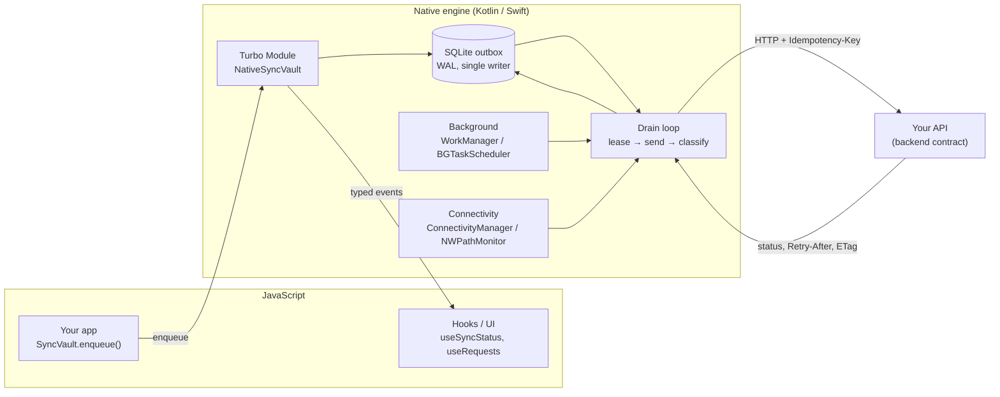
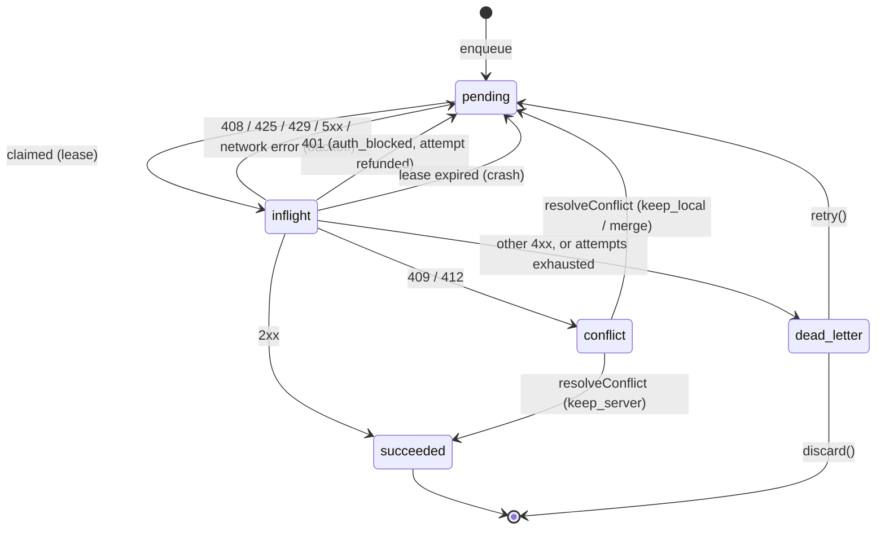

# react-native-sync-vault

[](https://www.npmjs.com/package/react-native-sync-vault)
[](https://www.npmjs.com/package/react-native-sync-vault)
[](https://www.npmjs.com/package/react-native-sync-vault)

A durable, native outbox for React Native. Mutations you hand to Sync Vault are committed to SQLite on the device and delivered to your server **at least once, applied exactly once**: they survive offline periods, app kills, crashes, and reboots, and they keep syncing in the background without a JavaScript runtime.

v2 is a rewrite. The delivery engine now lives entirely in native code (Kotlin on Android, Swift on iOS) behind a single [Turbo Module](https://reactnative.dev/docs/turbo-native-modules-introduction), and both platforms implement the same state machine, retry policy, and SQL schema. JavaScript only configures the engine, enqueues requests, and listens to events.

📹 **Demo Video**: [Watch on YouTube](https://www.youtube.com/watch?v=Gs1bcV6Zw3k)

## Contents

- [Guarantees](#guarantees)
- [How it works](#how-it-works)
- [Requirements](#requirements)
- [Installation](#installation)
- [Quick start](#quick-start)
- [Core concepts](#core-concepts)
- [Configuration](#configuration)
- [API reference](#api-reference)
- [Backend contract](#backend-contract)
- [Testing](#testing)
- [Migrating from v1](#migrating-from-v1)
- [Example app](#example-app)
- [Development](#development)

## Guarantees

| Guarantee | How |
| --- | --- |
| A request is never lost once `enqueue()` resolves | It resolves only after the row is committed to SQLite (WAL mode) on the native DB queue. |
| Applied exactly once on the server | Every request carries an `Idempotency-Key` (UUIDv7) that stays the same across all retries; the server replays the stored response for duplicates. |
| Ordered per entity | Requests sharing a `queueKey` are delivered strictly one after another, in enqueue order. |
| Newest change wins | A newer request with the same `dedupeKey` replaces a pending older one, and an older body can never overwrite a newer one. |
| Crash-safe in-flight work | In-flight rows hold a lease. After a crash the lease expires and the row is retried with the same idempotency key, or dead-lettered if that was its last attempt. |
| Delivery without JS | WorkManager (Android) and BGTaskScheduler plus a background `URLSession` (iOS) drain the queue while the app is suspended or killed. |
| Token refresh doesn't burn retries | A 401 parks the request, asks JS for fresh headers, and refunds the attempt. |
| Conflicts are surfaced, not overwritten | 409/412 move the request to `conflict` with the server's body and version, for your resolver or UI. |

These guarantees are verified by one shared contract suite. It runs in Jest against the in-memory engine, and on device against the real Kotlin and Swift engines (see [Testing](#testing)).

## How it works



1. `SyncVault.enqueue()` serializes the request and hands it to the Turbo Module, which inserts it into the outbox in one transaction and returns its id.
2. The drain loop claims eligible rows. A row is eligible when it is `pending`, its retry time has passed, it isn't blocked on auth, and no older unfinished row shares its `queueKey` or `dedupeKey`. Claiming takes a lease and moves the row to `inflight`.
3. The response is classified with the same table on every platform, and the row moves to its next state in a single transaction.
4. Events (`enqueued`, `attempt`, `succeeded`, `retry_scheduled`, …) are emitted to JS when a JS runtime is attached; hooks update from them without polling.
5. When the app is in the background or killed, the platform scheduler wakes the engine at the next retry time and when connectivity returns.

### Request lifecycle



| Response | Outcome | What happens |
| --- | --- | --- |
| `2xx` | success | `succeeded`; kept for 7 days for inspection, then purged. |
| `401` | auth | Parked as `authBlocked`, JS is asked for new headers, the attempt is refunded. |
| `409`, `412` | conflict | `conflict` with the server body and `ETag`; resolved by strategy, resolver, or UI. |
| `408`, `425`, `429`, `5xx`, network error | retryable | Back to `pending` at `now + max(Retry-After, backoff)`. |
| any other `4xx` | permanent | `dead_letter` immediately; never retried automatically. |

Backoff is exponential with full jitter: `random(0, min(retryMaxDelayMs, retryBaseDelayMs × 2^(attempt−1)))`. `Retry-After` is honoured in both delta-seconds and HTTP-date form. After `maxAttempts` retryable failures the request is dead-lettered.

### Platform features

| | Android | iOS |
| --- | --- | --- |
| Storage | SQLite (WAL) in `noBackupFilesDir` | SQLite (WAL), file protection `completeUntilFirstUserAuthentication`, excluded from backup |
| Connectivity | `ConnectivityManager` network callbacks | `NWPathMonitor` |
| Background drain | WorkManager: expedited one-time work, delayed work at the next retry time, periodic work | `BGProcessingTask` + `BGAppRefreshTask`, `beginBackgroundTask` to finish an in-progress drain |
| Large payloads | Stored as files, uploaded by a `dataSync` foreground service | Stored as files, uploaded by a background `URLSession` that continues after the app is killed |
| Encryption at rest (opt-in) | AES-256-GCM, non-exportable Android Keystore key | AES-256-GCM, Keychain key (`AfterFirstUnlockThisDeviceOnly`) |
| HTTP | OkHttp | `URLSession` |

## Requirements

- React Native **0.76+** with the **New Architecture** enabled (the default in 0.76). The legacy bridge is not supported.
- React 18+.
- iOS 15.1+, Android API 24+.

## Installation

```bash
npm install react-native-sync-vault
npx sync-vault-init        # patches Info.plist and checks AndroidManifest.xml (--dry-run to preview)
cd ios && pod install
```

### iOS

`sync-vault-init` adds these keys to your app's `Info.plist`; add them by hand if you don't use the CLI:

```xml
<key>BGTaskSchedulerPermittedIdentifiers</key>
<array>
  <string>com.syncvault.drain</string>
  <string>com.syncvault.refresh</string>
</array>
<key>UIBackgroundModes</key>
<array>
  <string>processing</string>
  <string>fetch</string>
</array>
```

Background task handlers are registered by the library at process start, so no extra code is needed for them. To record large uploads that finish while the app is suspended or killed, forward the background `URLSession` callback in `AppDelegate.mm`:

```objc
#import <react-native-sync-vault/SyncVaultAppDelegate.h>

- (void)application:(UIApplication *)application
    handleEventsForBackgroundURLSession:(NSString *)identifier
                      completionHandler:(void (^)(void))completionHandler
{
  [SyncVaultAppDelegate handleEventsForBackgroundURLSession:identifier completionHandler:completionHandler];
}
```

> **Xcode 26+ with React Native 0.76:** the bundled `fmt` 11.0.2 pod doesn't compile as C++20 with newer clang. Add this to the `post_install` block of your `Podfile`:
>
> ```ruby
> installer.pods_project.targets.each do |target|
>   next unless target.name == 'fmt'
>   target.build_configurations.each { |c| c.build_settings['CLANG_CXX_LANGUAGE_STANDARD'] = 'c++17' }
> end
> ```

### Android

Nothing to add: autolinking registers the module, and the library manifest merges `INTERNET`, `ACCESS_NETWORK_STATE`, `FOREGROUND_SERVICE`, `FOREGROUND_SERVICE_DATA_SYNC`, and the WorkManager foreground service with `foregroundServiceType="dataSync"`. `sync-vault-init` warns if your app manifest removes any of them with `tools:node="remove"`.

## Quick start

Configure the engine **once, at app start, outside React** (for example in `index.js`). Background launches on iOS and Android may start your JS without mounting any component.

```ts
// index.js
import { SyncVault } from 'react-native-sync-vault';
import { tokenStore } from './auth';

SyncVault.configure({
  baseUrl: 'https://api.example.com',
  // Called at configure time and on every 401; headers are stored natively and
  // attached at send time, so a refreshed token applies to already-queued requests.
  getAuthHeaders: async () => ({ Authorization: `Bearer ${await tokenStore.freshToken()}` }),
  conflictResolver: (conflict) => ({ action: 'keep_server' }),
  onEvent: (event) => logger.debug('sync', event),
});
```

Queue mutations with client-generated IDs, and update the UI optimistically:

```ts
import { SyncVault } from 'react-native-sync-vault';

async function addTodo(title: string) {
  const todo = { id: SyncVault.generateId(), title, done: false }; // UUIDv7
  setTodos((list) => [...list, todo]);                             // optimistic
  await SyncVault.enqueue({
    method: 'POST',
    url: '/todos',
    body: todo,
    queueKey: `todo:${todo.id}`,  // create → update → delete stay in order
  });
}

async function toggleTodo(todo: Todo) {
  await SyncVault.enqueue({
    method: 'PATCH',
    url: `/todos/${todo.id}`,
    body: { done: !todo.done },
    queueKey: `todo:${todo.id}`,
    dedupeKey: `todo:${todo.id}:done`, // rapid taps collapse into one request
  });
}
```

Show sync state anywhere:

```tsx
import { useSyncStatus, useFailedRequests } from 'react-native-sync-vault';

function SyncBadge() {
  const { isOnline, pendingCount, counts, isDraining } = useSyncStatus();
  return <Text>{isOnline ? 'online' : 'offline'} · {pendingCount} pending · {counts.deadLetter} failed</Text>;
}

function FailedList() {
  const { requests, retry, discard } = useFailedRequests();
  return requests.map((r) => (
    <Row key={r.id} title={`${r.method} ${r.url}`} subtitle={r.lastError} onRetry={() => retry(r.id)} onDiscard={() => discard(r.id)} />
  ));
}
```

## Core concepts

### Idempotency keys

Each request gets an `Idempotency-Key` header, defaulting to its UUIDv7 id. The key never changes across retries, so a request whose response was lost is replayed by the server instead of applied twice. Pass `idempotencyKey` to reuse a key you already have. The key is rotated only when the payload changes after it may already have been sent: on coalescing (see below) and on conflict resolution.

### Ordering with `queueKey`

Requests with the same `queueKey` are delivered strictly in enqueue order; a later request waits until the earlier one reaches a terminal state or a conflict. Requests with different keys (or no key) are sent in parallel, up to `maxConcurrency`. Use one key per entity, such as `todo:<id>`.

### Coalescing with `dedupeKey`

When a request with a `dedupeKey` is enqueued and the newest unfinished request with that key is still `pending`, its body is replaced instead of a second row being added. If the newest one is already in flight or in conflict, the new request is queued behind it, so an older body can never overwrite a newer one on the server.

### Client-generated IDs

Create records offline with `SyncVault.generateId()` (RFC 9562 UUIDv7, time-ordered). Your server should accept the client ID as the primary key, which makes creates naturally idempotent and lets follow-up updates reference the record before it exists on the server.

### Authentication

Provide `getAuthHeaders` instead of baking tokens into queued requests. Headers are stored natively and attached at send time. On a 401 the request is parked (`authBlocked`) without spending an attempt, JS is asked once for fresh headers (single-flight), and all parked requests resume. If JS isn't running, requests stay parked until the next `configure()` or `setAuthHeaders()`.

### Conflicts

A `409` or `412` moves the request to `conflict` and stores the server's body and `ETag`. What happens next depends on the request's `conflictStrategy`:

| Strategy | Behaviour |
| --- | --- |
| `manual` (default) | Stays in `conflict` until `conflictResolver` or your UI calls `resolveConflict()`. |
| `client_wins` | Resent natively with the server's version as `If-Match`. |
| `server_wins` | The local change is dropped. |
| `merge` | Your `merge(local, server)` function (or the global resolver) runs in JS; the result is sent with the server's version as `If-Match`. |

`resolveConflict(id, { action: 'keep_local' | 'keep_server' | 'merge', payload })` persists the resolved payload natively with a new idempotency key and a fresh attempt budget, so the resolution survives an app kill. Conflicts produced by background drains are handed to `conflictResolver` the next time `configure()` runs.

### Dead letters

Permanent failures and requests that run out of attempts move to `dead_letter`. They're never retried automatically; use `retry(id)`, `retryAllDeadLetters()`, or `discard(id)`, or the `useFailedRequests()` hook.

### Background delivery

`configure()` schedules a periodic background drain every `backgroundIntervalMinutes` (default 15; `0` disables it). Independently of that, the engine schedules a one-time wake-up for the next retry time and drains when connectivity returns. The OS decides the exact timing, especially on iOS, where `BGTaskScheduler` runs tasks opportunistically.

### Resource constraints

`wifiOnly`, `requiresCharging`, and `minBatteryLevel` pause draining (not enqueuing) until the condition holds; they also constrain the background scheduler.

## Configuration

All options are optional. `configure()` can be called again to change settings; the configuration is persisted natively so background workers use it without JS.

| Option | Default | Description |
| --- | --- | --- |
| `baseUrl` | `''` | Relative request URLs are resolved against this at send time. |
| `maxConcurrency` | `4` | Parallel requests across different `queueKey`s. |
| `requestTimeoutMs` | `30000` | Per-request timeout. |
| `leaseMs` | `120000` | Minimum in-flight lease; extended to `2 × timeout + 10s`. |
| `maxAttempts` | `8` | Retryable attempts before dead-lettering (per-request override available). |
| `retryBaseDelayMs` | `1000` | Backoff base. |
| `retryMaxDelayMs` | `300000` | Backoff cap. |
| `encryptPayloads` | `false` | Encrypt stored bodies and headers with a device-bound key. |
| `wifiOnly` | `false` | Only drain on unmetered networks. |
| `requiresCharging` | `false` | Only drain while charging. |
| `minBatteryLevel` | `0` | `0..1`; below this (and not charging) draining pauses. |
| `backgroundIntervalMinutes` | `15` | Periodic background drain; `0` disables. |
| `largePayloadThresholdBytes` | `262144` | Bodies above this are stored as files and uploaded in the background. |
| `notificationTitle` | `'Syncing'` | Android foreground-service notification title for large uploads. |
| `getAuthHeaders(context)` | – | Returns headers; called at configure time, on 401, and on `refreshAuth()`. |
| `conflictResolver(conflict)` | – | Returns a `ConflictResolution` for `manual` and `merge` requests. |
| `onEvent(event)` | – | Every engine event, for logging or monitoring. |
| `onError(error, context)` | – | Errors thrown by your providers, resolvers, and listeners. |

### Enqueue options

| Option | Description |
| --- | --- |
| `method`, `url` | Required. `url` may be absolute or relative to `baseUrl`. |
| `body` | Objects are JSON-serialized; strings are sent as-is. `FormData`, `Blob`, and binary bodies must be serialized first. |
| `headers`, `queryParams`, `contentType` | Sent with the request. |
| `idempotencyKey` | Defaults to the request id. |
| `queueKey` | Strict per-key ordering. |
| `dedupeKey` | Newest pending change replaces older ones. |
| `ifMatch` | Sent as `If-Match` for optimistic concurrency. |
| `priority` | Higher first (default `0`), within ordering constraints. |
| `maxAttempts` | Overrides the global value. |
| `conflictStrategy`, `merge` | See [Conflicts](#conflicts). `merge` functions live in memory, so a request whose process died falls back to `conflictResolver`. |
| `metadata` | Arbitrary JSON stored with the request. |

## API reference

### `SyncVault`

| Method | Description |
| --- | --- |
| `configure(config)` | Persist config, install auth/conflict handlers, schedule background drain, start draining. |
| `enqueue(options)` | Durably queue a request; resolves with its id after commit. |
| `generateId()` | UUIDv7 for client-generated primary keys. |
| `getRequests({ status, queueKey, limit, offset })`, `getRequest(id)` | Inspect the outbox. |
| `getPending()`, `getDeadLetters()`, `getConflicts()`, `getCounts()` | Shortcuts. |
| `retry(id)`, `retryAllDeadLetters()`, `discard(id)`, `purgeSucceeded(olderThanMs)` | Manage requests. |
| `resolveConflict(id, resolution)` | Resolve a request in `conflict`. |
| `setAuthHeaders(headers)`, `refreshAuth()` | Push credentials (e.g. after login) and unblock parked requests. |
| `drainNow()` | Drain immediately (still subject to connectivity and constraints). |
| `scheduleBackgroundDrain(options)`, `cancelBackgroundDrain()` | Control the periodic background drain. |
| `getNetworkState()`, `getPowerState()` | Synchronous snapshots from native monitors. |
| `addEventListener(fn)`, `addNetworkListener(fn)`, `addConflictListener(fn)` | Subscribe; each returns an unsubscribe function. |
| `cache.get/set/delete/invalidate/clear/stats/evict` | Native response cache with TTL, tags, and LRU eviction. |

Event types: `enqueued`, `coalesced`, `attempt`, `succeeded`, `retry_scheduled`, `dead_lettered`, `conflict`, `conflict_resolved`, `discarded`, `auth_blocked`, `drain_started`, `drain_finished`. Each event carries `id`, `status`, `attempt`, `httpStatus`, `error`, `nextAttemptAt`, and `timestamp`. Events are emitted only while a JS runtime is attached; anything that happened in the background is reflected in the outbox, which hooks re-read when they subscribe.

### Hooks

| Hook | Returns |
| --- | --- |
| `useSyncStatus()` | `counts`, `network`, `isOnline`, `pendingCount`, `isDraining`, `lastEvent`, `drainNow`, `retryAllDeadLetters` |
| `useNetworkState()` | Current `NetworkState` |
| `useRequests(query)` | Live list of requests matching a query |
| `usePendingRequests()` | Pending and in-flight requests |
| `useFailedRequests()` | Dead letters plus `retry`, `retryAll`, `discard` |
| `useConflicts()` | Conflicts plus `resolve(id, resolution)` |
| `useRequestStatus(id)` | One request, updated until it settles |
| `useOfflineMutation({ request, invalidate, onQueued })` | `mutate(vars)` that queues durably, plus `isPending`, `lastRequestId` |
| `useOfflineQuery(url, { fetcher, ttl, strategy, tags })` | Cached read that falls back to the last copy offline |
| `useCache(key)` | Read and write one cache entry |
| `useSyncMetrics()` | Success rate, latency, and queue metrics |
| `useBackgroundSync()` | `schedule`, `cancel`, `drainNow` |

All hooks subscribe to engine events through a shared store; none of them poll.

### Interceptors

If you'd rather keep calling `fetch` or axios, interceptors queue mutations (`POST`, `PUT`, `PATCH`, `DELETE` by default) when the device is offline or the request fails at the network level:

```ts
import { interceptFetch, interceptAxios } from 'react-native-sync-vault';

const stopFetch = interceptFetch({ urlFilter: ['https://api.example.com'] });
const stopAxios = interceptAxios(axiosInstance);
```

A queued call resolves with a synthetic `202` whose body is `{ queued: true, requestId }`. Every intercepted mutation gets an `Idempotency-Key` before its first attempt, so a request that fails online and is then queued can't be applied twice. Explicit `SyncVault.enqueue()` is still recommended because it lets you set `queueKey` and `dedupeKey`.

### UI components

`OfflineProvider`, `OfflineStatusBar`, `QueuedActionsBadge`, and `SyncProgress` render from `useSyncStatus()`. `DebugScreen`, `SyncDashboard`, and `QueueLogger` help during development.

### Integrations

```ts
// TanStack Query: queue mutations and invalidate queries when they're delivered
import { syncVaultMutationFn, withSyncVaultReactQuery } from 'react-native-sync-vault';
useMutation({ mutationFn: syncVaultMutationFn((todo) => ({ method: 'POST', url: '/todos', body: todo })) });
withSyncVaultReactQuery(queryClient, ({ url }) => [['todos']]);

// Zustand: adds a `syncVault` slice with enqueue, drainNow, getCounts
import { withSyncVaultZustand } from 'react-native-sync-vault';
const useStore = create(withSyncVaultZustand((set, get) => ({ /* ... */ })));

// Redux: actions with `meta.syncVault` are reduced optimistically and queued;
// `${type}/queued` is dispatched with the request id, and engine events as `syncVault/event`
import { createSyncVaultMiddleware } from 'react-native-sync-vault';
const store = createStore(reducer, applyMiddleware(createSyncVaultMiddleware()));
```

## Backend contract

Exactly-once needs cooperation from the server. The full contract is in [docs/BACKEND_CONTRACT.md](docs/BACKEND_CONTRACT.md); in short:

- **Idempotency:** store the response for each `Idempotency-Key` (scoped per user) and replay it for duplicates. Return `422` if a key is reused with a different payload, and `425` with `Retry-After` while the original request is still processing.
- **Optimistic concurrency:** return an `ETag` with each resource version, check `If-Match`, and answer a mismatch with `412`, the current body, and its `ETag`.
- **Retry signalling:** send `Retry-After` with `429` and `503`. Use `4xx` only for requests that will never succeed.
- **Client IDs:** accept client-generated UUIDv7 primary keys on create.
- **Batch (optional):** `POST /sync/batch` with ordered operations, each carrying its own `Idempotency-Key`.

[`server/express-sync-vault`](server/express-sync-vault) is a reference Express implementation (`idempotency`, `ifMatch`, `setETag`, `retryAfter`, `rateLimit`, `batchRouter`, `MemoryStore`, `RedisStore`). It's also the server the test suites run against.

## Testing

### Testing your app

`MemorySyncVault` is a pure-TypeScript engine with the same semantics as the native ones. Swap it in with `setNativeImplementation` to unit-test code that uses Sync Vault in Jest, without a device:

```ts
import { setNativeImplementation, SyncVault } from 'react-native-sync-vault';
import { MemorySyncVault } from 'react-native-sync-vault/lib/testing';

beforeEach(() => setNativeImplementation(new MemorySyncVault()));
```

### How the library is verified

| Suite | What it covers |
| --- | --- |
| Contract (`src/testing/contract.ts`) | Enqueue, delivery, ordering, retries, connectivity, auth, conflicts, coalescing, durability, management, cache. One suite that any engine must pass. |
| Native contract (example app) | The same guarantees run through the real Turbo Module over real HTTP on a simulator/emulator, against the reference server. Android and iOS must report identical results. |
| Chaos | Kills the engine mid-request and injects 5xx, 429, and dropped responses; asserts every effect is applied exactly once. |
| State-machine property tests | Thousands of seeded random operation sequences checked against the outbox invariants (`SYNC_VAULT_SEEDS`, `SYNC_VAULT_SEED`, `SYNC_VAULT_TRACE`). |
| Migration | The v1-to-v2 import SQL against real SQLite (`node:sqlite`, Node 22.13+). |
| Retry policy | The shared classification and backoff table. |

To run the native contract on a device or simulator, start the reference server and Metro, then launch the example app in contract mode. Results show on the Contract tab and are posted to the server:

```bash
cd examples/todo-app
npm run server        # reference server with the test control API on :4000
npm start             # Metro

# iOS (simulator)
xcrun simctl launch booted org.reactjs.native.example.SyncVaultTodo -SyncVaultContract autorun
# Android (emulator)
adb shell am start -a android.intent.action.VIEW -d "syncvaulttodo://contract" com.syncvaulttodo

curl localhost:4000/__control/report   # { platform, passed, total, results }
```

## Migrating from v1

- **Breaking:** React Native 0.76+ with the New Architecture is required, and the legacy bridge module is gone.
- **Breaking:** the engine is a singleton configured with `SyncVault.configure()` at app start instead of the `useOfflineQueue()` hook owning it.
- **Automatic:** queued v1 requests are imported into the v2 outbox on first launch ([`schema/sync_vault/import_v1.sql`](schema/sync_vault/import_v1.sql)).
- **Compatibility:** the default export `OfflineQueue` (`initialize`, `push`, `getPendingRequests`, …) and `useOfflineQueue()` still work and map onto `SyncVault`. They're deprecated.

| v1 | v2 |
| --- | --- |
| `OfflineQueue.initialize(config)` | `SyncVault.configure(config)` |
| `queue.push({ data, maxRetries })` | `SyncVault.enqueue({ body, maxAttempts })` (`maxAttempts = maxRetries + 1`) |
| `queue.sync()` / `triggerSync()` | `SyncVault.drainNow()` |
| `getFailedRequests()` | `SyncVault.getDeadLetters()` / `useFailedRequests()` |
| `conflictResolution: 'custom'` + `customResolver` | `conflictStrategy: 'merge'` + `merge`, or a global `conflictResolver` |
| Static auth headers in each request | `getAuthHeaders` provider |

See [docs/MIGRATION.md](docs/MIGRATION.md) for details.

## Example app

[`examples/todo-app`](examples/todo-app) is a React Native 0.76 New Architecture app with two tabs:

- **Todos:** an offline-first todo list with optimistic updates, per-todo ordering, coalesced toggles, and live sync status.
- **Contract:** runs the native contract scenarios against the reference server.

```bash
cd examples/todo-app
npm install && npm run pods
npm run server
npm run ios    # or: npm run android
```

## Development

```bash
npm test               # Jest: contract, chaos, property, migration, unit tests
npm run lint
npm run type-check
npm run codegen:check  # the Turbo Module spec matches the Kotlin and Objective-C++ implementations
npm run build
```

The Kotlin, Swift, and TypeScript engines share the schema in [`schema/sync_vault`](schema/sync_vault) and the retry table; changes to one must be mirrored in the others, and the contract suite is the arbiter.

## What it isn't

- Not a local database or ORM (see WatermelonDB or op-sqlite). Sync Vault queues *writes to your server*; your app keeps its own local state.
- Not a two-way sync engine. It delivers outgoing mutations reliably; pulling changes down (for example delta sync) is up to your app. See the backend contract for a recommended approach.
- Not a general-purpose query cache, although it includes a small native response cache for offline reads.

## Contributing

We welcome contributions! Please see [CONTRIBUTING.md](CONTRIBUTING.md) for guidelines.

## License

MIT

## Support

- 📖 [Documentation](docs/)
- 🐛 [Report Issues](https://github.com/126punith/react-native-sync-vault/issues)
- 💬 [Discussions](https://github.com/126punith/react-native-sync-vault/discussions)
- 📧 Email: punithm300@gmail.com

---

**Made with ❤️ for the React Native community**

---

## 🗺️ Option B Evolution: The Local Data Layer Roadmap

Sync Vault is shifting from a durable outbox to a **complete, reactive, offline-first data layer**. We are actively expanding the native SQLite core to manage your local source of truth, handle local relational queries, and surface reactive updates directly to your UI components.

### Progress & Upcoming Milestones
- [x] **Native Outbox Core:** Transactional SQLite engine with native retry state machines (Kotlin/Swift).
- [ ] **Declarative Relational Schema:** Define local models, indexes, and relationships (`hasMany`, `belongsTo`) directly over the native DB.
- [ ] **Reactive Observation Layer:** Live table and row-level SQL hooks that auto-trigger UI updates when data changes, eliminating manual state synchronization.
- [ ] **Hybrid Synchronisation Engine:** Native-driven conflict resolution leveraging local operation tracking to seamlessly reconcile state with your server.

---

## 💡 How It Integrates with the Pro Ecosystem

`react-native-sync-vault` is, and will always remain, **100% free and open-source** under the MIT license. It serves as the open foundation for highly resilient, offline-capable application architectures.

If your application requires enterprise-grade background tracking infrastructure that integrates seamlessly with your local database architecture, check out our premium sibling module:
- 🤖 [React Native Background Location Pro (Android)](https://github.com/126punith/react-native-background-location-pro)
